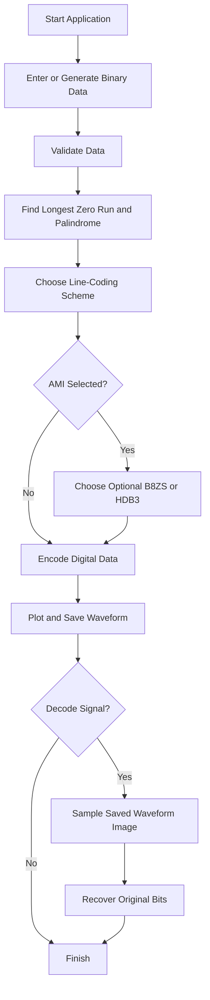
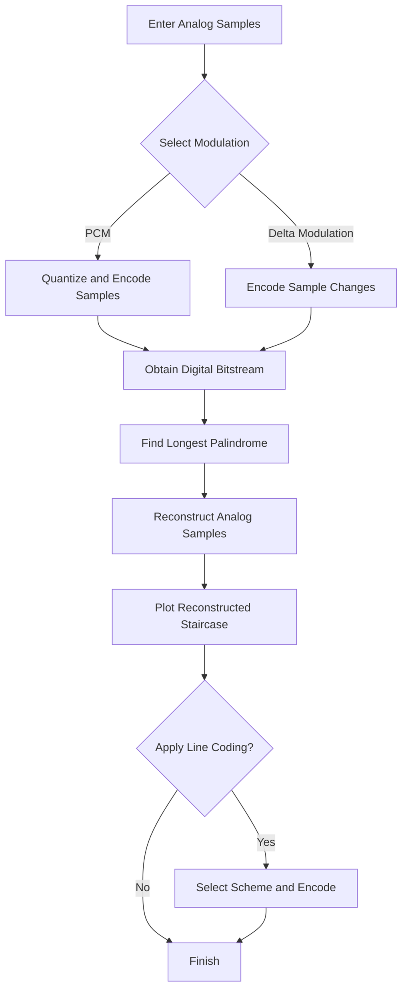

# ⚡ DC Assignment — Digital Signal Encoder & Decoder

<p align="center">
  <b>A Python-based Data Communication project</b><br>
  Digital Data Generation • Line Coding • Scrambling • PCM • Delta Modulation • Image-Based Decoding
</p>

<p align="center">
  
  
  
  
  
</p>

---

## 📌 About the Project

The **Digital Signal Encoder and Decoder** demonstrates how digital data is generated, encoded into electrical signal levels, transmitted using different line-coding schemes, and reconstructed through decoding.

The project also explores analog-to-digital conversion using Pulse Code Modulation (PCM) and Delta Modulation (DM). Encoded signals and reconstructed analog samples are visualized using waveform plots.

The application provides an interactive command-line interface and keeps the implementation modular while maintaining a simple folder structure.

### 🎯 Objectives

- Generate random binary data and test patterns containing consecutive zeros.
- Find the longest contiguous palindromic substring efficiently.
- Implement five digital line-coding schemes.
- Apply B8ZS and HDB3 scrambling to AMI signals.
- Implement PCM and Delta Modulation encoders and decoders.
- Visualize encoded signals and reconstructed staircases.
- Decode a line-coded signal by analysing its saved waveform image.
- Verify functionality through automated tests.

---

## ✨ Features at a Glance

| Feature | Description |
|---|---|
| 🔢 Digital Data Generation | Generate random bits, enter custom binary data, and create four/eight-zero test patterns. |
| 🔍 Palindrome Detection | Find the longest contiguous palindrome using Manacher's algorithm in \(O(n)\) time. |
| 📶 NRZ-L | Represent each bit with a fixed positive or negative voltage. |
| 🔄 NRZ-I | Represent a `1` by a transition at the beginning of the bit interval. |
| 📊 Manchester | Encode each bit using two half-bit voltage levels. |
| 🔁 Differential Manchester | Encode bits using transitions at the beginning and middle of each interval. |
| ⚡ AMI | Represent zeros with zero voltage and alternate the polarity of successive one pulses. |
| 🧩 B8ZS & HDB3 | Replace long zero runs with standard bipolar substitution patterns. |
| 🎚️ PCM | Quantize analog samples and encode them as fixed-width binary values. |
| 📈 Delta Modulation | Encode sample changes using one bit per sample and reconstruct a staircase signal. |
| 🖼️ Waveform Plotting | Save digital waveforms and reconstructed analog signals as PNG images. |
| 🔓 Image-Based Decoding | Sample the plotted waveform image and recover the transmitted bitstream. |
| ✅ Automated Testing | Verify the main algorithms and processing functions using `unittest`. |

---

## 🗂️ Project Structure

The project uses a **flat folder structure**. All source files, configuration files, tests, and documentation are kept directly in the repository root. No additional source or test directories are required.

```text
DC_Assignment/
│
├── main.py                  # Interactive application entry point
│
├── data_generator.py        # Random bit generation and validation
├── palindrome.py            # Longest palindromic substring algorithm
├── line_coding.py           # NRZ-L, NRZ-I, Manchester, Differential Manchester, AMI
├── scrambling.py            # B8ZS and HDB3 encoding/decoding
├── modulation.py             # PCM and Delta Modulation
├── plotter.py                # Waveform and staircase visualization
├── decoder.py                # Waveform-image-based line-code decoder
│
├── test_project.py           # Automated unit tests
├── requirements.txt          # Python dependencies
├── README.md                 # Project documentation
└── .gitignore                # Files excluded from Git
```

### 🧭 Understanding the file responsibilities

| File | Responsibility |
|---|---|
| `main.py` | Accepts user choices and coordinates generation, encoding, plotting, and optional decoding. |
| `data_generator.py` | Generates binary strings, inserts consecutive-zero patterns, validates input, and detects the longest zero run. |
| `palindrome.py` | Implements Manacher's algorithm and returns the longest palindrome, its length, and its starting index. |
| `line_coding.py` | Converts binary input into voltage levels using the five required line-coding schemes. |
| `scrambling.py` | Applies and reverses B8ZS/HDB3 substitutions for AMI signals. |
| `modulation.py` | Implements PCM and Delta Modulation encoding and reconstruction. |
| `plotter.py` | Generates and saves encoded waveform and reconstructed staircase plots. |
| `decoder.py` | Samples a saved waveform image and reconstructs the encoded digital data. |
| `test_project.py` | Contains automated tests for the implemented features. |
| `requirements.txt` | Lists the libraries needed by the project. |
| `.gitignore` | Prevents selected generated files and local environment files from being tracked. |

---

## 🛠️ Technology Stack

| Technology | Purpose |
|---|---|
| **Python 3.10+** | Main programming language |
| **NumPy** | Numerical operations where required |
| **Matplotlib** | Plotting digital waveforms and analog reconstructions |
| **Pillow** | Reading PNG images and sampling waveform pixels |
| **unittest** | Automated testing |
| **Git & GitHub** | Version control and source-code hosting |
| **Visual Studio Code** | Development environment |

---

## ✅ Prerequisites

Before running the project, ensure the following are installed:

1. **Python 3.10 or newer** — required to execute the application.
2. **Visual Studio Code** — recommended for editing and running the project.
3. **Git** — required to clone the repository and manage commits.
4. **Python dependencies** — installed through `requirements.txt`.

Check your installed versions:

```powershell
python --version
git --version
```

If Python is not recognized on Windows, install it and ensure it is available in your system's PATH.

---

## 🚀 Installation and Setup

### Step 1 — Clone the repository

Open the VS Code terminal and execute:

```powershell
git clone https://github.com/jithendra847/DC_Assignment.git
cd DC_Assignment
```

### Step 2 — Create a virtual environment

A virtual environment isolates this project's dependencies from other Python projects.

```powershell
python -m venv .venv
```

Activate it in Windows PowerShell:

```powershell
.\.venv\Scripts\Activate.ps1
```

If activation is blocked by your PowerShell execution policy, you can still run the environment's Python executable directly, or use the VS Code Command Palette to select `.venv` as your interpreter.

### Step 3 — Install dependencies

```powershell
python -m pip install --upgrade pip
python -m pip install -r requirements.txt
```

### Step 4 — Run the application

```powershell
python main.py
```

Follow the interactive prompts to select a data-input mode, encoding scheme, and optional decoding operation.

---

## 🔄 How the Application Works

The program supports two input paths.

### 🔢 Digital Input Workflow



### 🎚️ Analog Input Workflow



### 🖼️ Image-Based Decoding

For line-code decoding, the program samples the saved waveform image to estimate voltage levels and then interprets those levels according to the selected scheme.

The decoder uses the image and required decoding metadata rather than receiving the original digital bitstream or encoder voltage array. B8ZS/HDB3 signals additionally require the appropriate descrambling logic.

---

## 📚 Algorithms and Signal Conventions

### Longest Palindromic Substring

The program uses **Manacher's algorithm** to find the longest contiguous palindrome.

- Time complexity: \(O(n)\)
- Auxiliary space complexity: \(O(n)\)
- Output: palindrome text, length, and zero-based starting index.
- If multiple maximum-length palindromes exist, the earliest occurrence is returned.

The longest consecutive-zero-run calculation is also performed in \(O(n)\) time.

### Line-Coding Conventions

| Scheme | Convention |
|---|---|
| NRZ-L | `0 → +1 V`, `1 → −1 V` |
| NRZ-I | `1` causes a transition at the beginning of a bit; `0` causes none. |
| Manchester | `0 → [+1, −1]`, `1 → [−1, +1]` |
| Differential Manchester | Every bit transitions in the middle; `0` also transitions at the beginning. |
| AMI | `0 → 0 V`; successive `1` pulses alternate between `+1 V` and `−1 V`. |
| B8ZS | Replaces eight consecutive zeros using the standard `000VB0VB` substitution. |
| HDB3 | Replaces four consecutive zeros using `000V` or `B00V`, depending on the applicable polarity and parity rules. |

Initial voltage and pulse-polarity conventions must be consistent between the corresponding encoder and decoder.

### Analog Modulation

**Pulse Code Modulation (PCM)** quantizes analog sample values and represents each quantized value as a fixed-width binary codeword. Decoding reconstructs an approximation using the quantization information.

**Delta Modulation (DM)** encodes whether the reconstructed level needs to increase or decrease. Its decoder rebuilds the signal using a configurable step size and initial reference level, producing a staircase approximation.

---

## 🧪 Testing and Verification

The project includes `test_project.py` for automated testing with Python's built-in `unittest` framework.

Run the tests from the repository root:

```powershell
python -m unittest test_project -v
```

The tests should cover the implemented functions, including:

- Random data generation and binary input validation.
- Four/eight-zero generation and longest-zero-run detection.
- Longest palindrome detection and edge cases.
- Line-coding voltage levels and transition rules.
- AMI, B8ZS, and HDB3 substitution and decoding.
- PCM quantization and Delta Modulation reconstruction.
- Waveform plotting, image sampling, and line-code recovery.

**Important:** run the tests after modifying the source code. Successful tests do not replace manual verification of the application's interactive paths and generated plots.

---

## ⚠️ Assumptions and Limitations

- Binary input must contain only `0` and `1`.
- PCM uses uniform quantization according to the implemented configuration, and input values outside the supported range may be clipped.
- Delta Modulation requires a valid positive step size.
- Encoders and decoders must use matching polarity conventions and initial reference levels.
- Image-based decoding depends on the waveform style and calibration used by the project's plotter. Constant-level or visually ambiguous waveforms may not contain enough information for reliable image-based decoding.
- Generated waveform PNG files may be excluded from Git by `.gitignore`; save or submit required plots separately if requested.

---

## Technical References and Acknowledgements

### Learning Resources and Documentation

- [DeepLearning.AI — AI Python for Beginners](https://www.deeplearning.ai/courses/ai-python-for-beginners) — Used to learn Python fundamentals, functions, working with modules, and using external libraries.
- [NumPy Official Documentation](https://numpy.org/doc/stable/) — Consulted for numerical operations and array-related concepts.
- [Matplotlib Official Documentation](https://matplotlib.org/stable/) — Consulted for plotting digital waveforms and reconstructed staircase signals.


### AI Assistance Acknowledgement

**Claude (Anthropic)** and **ChatGPT (OpenAI)** were used as supporting tools during development. They helped break down the project requirements, understand the implementation approach and relevant technical concepts, explore the appropriate technology stack, and investigate errors encountered while debugging the code. Their explanations were also used to clarify selected algorithms and signal-processing concepts. Suggestions were reviewed and applied as appropriate during implementation and testing.

These resources supported the learning and development process. The project was tested against its intended functionality, and the implementation and its limitations should be understood and verified before use or further development.

---

## 👨‍💻 Author and Project Repository

**Repository:** [github.com/jithendra847/DC_Assignment](https://github.com/jithendra847/DC_Assignment)

**Project:** Digital Signal Encoder and Decoder  
**Course:** Data Communication

Built as an academic project to explore digital line coding, scrambling, analog-to-digital modulation, signal visualization, and decoding.

<p align="center">
  <b>⚡ Encode. Visualize. Decode. Understand. ⚡</b>
</p>